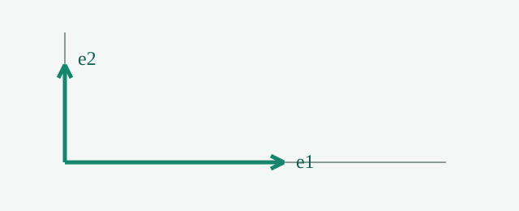

# 空间变换与矩阵

这是 **中文加粗** 与行内公式 $x^2+y^2=1$。

$$A=\begin{pmatrix}2&1\\0&1\end{pmatrix}$$



> 矩阵的列记录基向量的去向。

| 概念 | 含义 |
| --- | --- |
| 基 | 一组独立的基本方向 |
| 秩 | 输出空间的维数 |

```python
result = A @ vector
```
