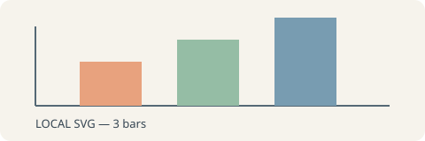
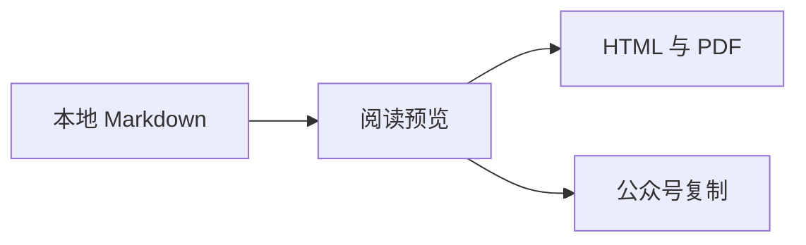
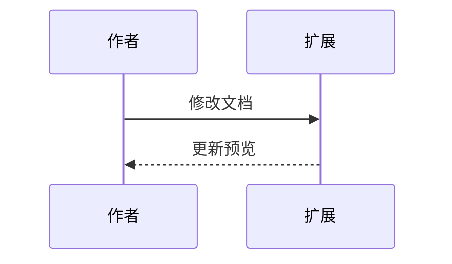

# Piper Markdown 独立验收

[TOC]

## 中文排版与公式

PARITY_OPENING：这是一份完全合成的验收文档，不包含个人数据。中文和 English、标点，以及 **粗体**、*斜体*、~~删除线~~ 应清晰可读。
这一行用于确认单换行偏好。

- [x] 阅读并理解
- [ ] 导出并核对

行内公式 $E=mc^2$；另一种分隔符 \(a^2+b^2=c^2\)。

$$
\begin{bmatrix}1&2\\3&4\end{bmatrix}
\quad \sum_{i=1}^{n} i=\frac{n(n+1)}2
$$

脚注示例[^parity]，以及 [[第二篇]]。

[^parity]: PARITY_FOOTNOTE：脚注文字与返回链接应完整。

## 本地资源





## 流程图与时序图





## 引入片段

@import "./parts/片段.md"

<!-- pagebreak -->

## 表格与代码

| 项目 | 可观察结果 | 状态 |
| :--- | :--- | ---: |
| 中文 | 标题、正文和混排没有缺字 | 1 |
| 图片 | PNG、SVG、GIF 保持比例 | 2 |
| 目录 | 中文标题可跳转 | 3 |
| 公式 | 行内与矩阵均完整 | 4 |

```javascript
const report = { title: '合成验收', status: 'ready' };
console.log(JSON.stringify(report, null, 2));
const longLine = 'PARITY_LONG_CODE_0123456789_ABCDEFGHIJKLMNOPQRSTUVWXYZ_0123456789_ABCDEFGHIJKLMNOPQRSTUVWXYZ_0123456789';
```

## 重复标题

首次出现的重复标题。

## 重复标题

第二次出现的重复标题，目录链接应指向不同位置。

### 阅读段落 01

PARITY_PARAGRAPH_01：阅读预览、HTML 与 PDF 应呈现同一份内容。每次导出保留中文、标点、段落之间的间距。页面底部不要裁切最后一行；跨页后应继续同一条阅读顺序。

### 阅读段落 02

PARITY_PARAGRAPH_02：阅读预览、HTML 与 PDF 应呈现同一份内容。每次导出保留中文、标点、段落之间的间距。页面底部不要裁切最后一行；跨页后应继续同一条阅读顺序。

### 阅读段落 03

PARITY_PARAGRAPH_03：阅读预览、HTML 与 PDF 应呈现同一份内容。每次导出保留中文、标点、段落之间的间距。页面底部不要裁切最后一行；跨页后应继续同一条阅读顺序。

### 阅读段落 04

PARITY_PARAGRAPH_04：阅读预览、HTML 与 PDF 应呈现同一份内容。每次导出保留中文、标点、段落之间的间距。页面底部不要裁切最后一行；跨页后应继续同一条阅读顺序。

### 阅读段落 05

PARITY_PARAGRAPH_05：阅读预览、HTML 与 PDF 应呈现同一份内容。每次导出保留中文、标点、段落之间的间距。页面底部不要裁切最后一行；跨页后应继续同一条阅读顺序。

### 阅读段落 06

PARITY_PARAGRAPH_06：阅读预览、HTML 与 PDF 应呈现同一份内容。每次导出保留中文、标点、段落之间的间距。页面底部不要裁切最后一行；跨页后应继续同一条阅读顺序。

### 阅读段落 07

PARITY_PARAGRAPH_07：阅读预览、HTML 与 PDF 应呈现同一份内容。每次导出保留中文、标点、段落之间的间距。页面底部不要裁切最后一行；跨页后应继续同一条阅读顺序。

### 阅读段落 08

PARITY_PARAGRAPH_08：阅读预览、HTML 与 PDF 应呈现同一份内容。每次导出保留中文、标点、段落之间的间距。页面底部不要裁切最后一行；跨页后应继续同一条阅读顺序。

### 阅读段落 09

PARITY_PARAGRAPH_09：阅读预览、HTML 与 PDF 应呈现同一份内容。每次导出保留中文、标点、段落之间的间距。页面底部不要裁切最后一行；跨页后应继续同一条阅读顺序。

### 阅读段落 10

PARITY_PARAGRAPH_10：阅读预览、HTML 与 PDF 应呈现同一份内容。每次导出保留中文、标点、段落之间的间距。页面底部不要裁切最后一行；跨页后应继续同一条阅读顺序。

### 阅读段落 11

PARITY_PARAGRAPH_11：阅读预览、HTML 与 PDF 应呈现同一份内容。每次导出保留中文、标点、段落之间的间距。页面底部不要裁切最后一行；跨页后应继续同一条阅读顺序。

### 阅读段落 12

PARITY_PARAGRAPH_12：阅读预览、HTML 与 PDF 应呈现同一份内容。每次导出保留中文、标点、段落之间的间距。页面底部不要裁切最后一行；跨页后应继续同一条阅读顺序。

<!-- pagebreak -->

## 最后一页

PARITY_END：看到这句话说明正文末尾没有丢失。
