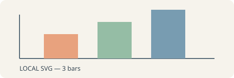

# Piper 公众号复制验收

[TOC]

## 中文、格式与链接

PARITY_WECHAT_COPY：这是一篇合成测试文章。检查中文标点、**粗体**、*斜体*、~~删除线~~与 [示例链接](https://example.com/)。

- 第一个项目
- 第二个项目

> 这段引用用于检查左侧线条与段落间距。

## 本地图片与动画





## 行内与块级公式

行内 $E=mc^2$ 与中文应在同一行，基线自然。

$$
\sum_{i=1}^{n}i=\frac{n(n+1)}2
$$

## 表格与代码

| 项目 | 预期 |
| --- | --- |
| 图片 | 无需登录可访问 |
| 公式 | 清晰且尺寸合理 |
| 动画 | 保留多帧 |

```javascript
const message = 'PARITY_WECHAT_CODE';
console.log(message);
```

PARITY_WECHAT_END：末尾内容应完整保留。
